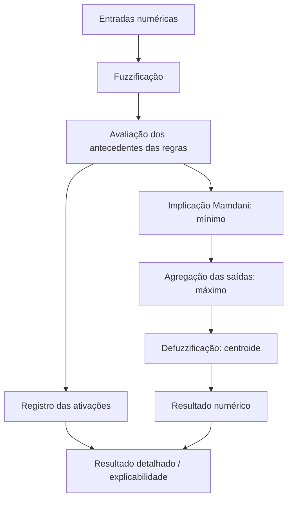
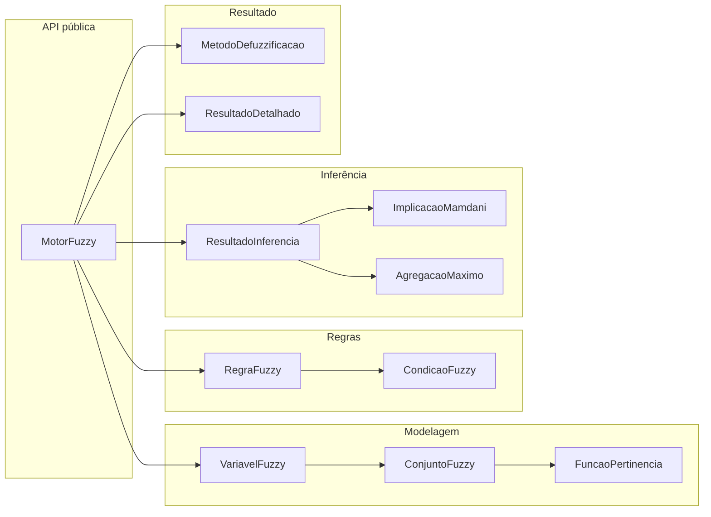

# Motor Fuzzy

**Biblioteca Java de lógica fuzzy, desenvolvida em português, para construir sistemas de inferência baseados em regras.**


## Objetivo

O **Motor Fuzzy** foi desenvolvido para estudar e aplicar os fundamentos da **lógica fuzzy** por meio de uma biblioteca Java reutilizável, independente do domínio de aplicação.

Diferentemente da lógica clássica, na qual uma condição é verdadeira ou falsa, a lógica fuzzy permite representar **graus de pertinência entre 0 e 1**. Assim, uma temperatura pode ser parcialmente *alta* e parcialmente *média*, por exemplo.

O projeto implementa um **sistema de inferência Mamdani** capaz de transformar entradas numéricas em uma saída numérica por meio de conjuntos fuzzy, operadores lógicos, regras linguísticas e defuzzificação.

A biblioteca foi pensada para servir como base para aplicações distintas, como **avaliação de jogos** e **análise de indicadores ambientais**, sem incorporar regras específicas desses domínios ao núcleo.

## Funcionalidades

- Funções de pertinência **triangular** e **trapezoidal**.
- Interface `FuncaoPertinencia` para implementar funções próprias.
- Criação de conjuntos e variáveis fuzzy de entrada e saída.
- Operadores de condições: **E** (mínimo), **OU** (máximo) e **NÃO** (complemento).
- Regras linguísticas no formato **SE ... ENTÃO ...**.
- Inferência **Mamdani**: implicação por mínimo e agregação por máximo.
- Defuzzificação pelo **centroide**, com resolução numérica configurável.
- Resultado detalhado com descrição e força de ativação das regras.
- **55 testes automatizados**, utilizando JUnit 5, aprovados na versão aqui documentada.

## Como funciona



### 1. Fuzzificação

Cada valor de entrada é avaliado pelas funções de pertinência dos conjuntos cadastrados na variável. O resultado são graus no intervalo `[0, 1]`.

### 2. Avaliação das regras

As condições podem ser simples ou compostas. Nesta implementação, os operadores são:

| Operador | Implementação | Expressão |
|---|---|---|
| E | `CondicaoE` | `min(a, b)` |
| OU | `CondicaoOu` | `max(a, b)` |
| NÃO | `CondicaoNao` | `1 - a` |

A força de ativação de cada regra é determinada pelo grau de seu antecedente.

### 3. Implicação e agregação Mamdani

O consequente de cada regra é recortado pela força de ativação:


As contribuições das regras para a variável de saída são combinadas pelo máximo:


### 4. Defuzzificação

A saída fuzzy agregada é convertida em um número pelo método do **centroide**:


A integração é **aproximada numericamente pela regra dos trapézios**. Por padrão são utilizadas 1.000 divisões; esse valor pode ser configurado por `new DefuzzificacaoCentroide(divisoes)`.

Se a área agregada calculada for zero, o método lança `IllegalStateException`, em vez de produzir uma nota arbitrária.

## Arquitetura

A biblioteca está dividida em componentes com responsabilidades específicas:



### Organização do código

```text
src/
├── main/java/br/com/motorfuzzy/
│   ├── conjuntos/          # ConjuntoFuzzy
│   ├── funcoes/            # FuncaoPertinencia, FuncaoTriangular, FuncaoTrapezoidal
│   ├── variaveis/          # VariavelFuzzy
│   ├── regras/             # CondicaoFuzzy, E, OU, NÃO, RegraFuzzy
│   ├── inferencia/         # ImplicacaoMamdani, AgregacaoMaximo, ResultadoInferencia
│   ├── defuzzificacao/     # MetodoDefuzzificacao, DefuzzificacaoCentroide
│   ├── explicabilidade/    # AtivacaoRegra, ResultadoDetalhado
│   └── nucleo/             # MotorFuzzy
└── test/java/br/com/motorfuzzy/
    └── ...                 # Testes unitários e de integração
```

## Exemplo de uso — Avaliação fuzzy de temperatura

Este é um exemplo mínimo que pode ser executado com a API atual, sem bibliotecas externas além do próprio Motor Fuzzy:

```java
import br.com.motorfuzzy.explicabilidade.ResultadoDetalhado;
import br.com.motorfuzzy.funcoes.FuncaoTriangular;
import br.com.motorfuzzy.nucleo.MotorFuzzy;
import br.com.motorfuzzy.regras.CondicaoSimples;
import br.com.motorfuzzy.regras.RegraFuzzy;
import br.com.motorfuzzy.variaveis.VariavelFuzzy;

import java.util.Map;

public class ExemploMotorFuzzy {

    public static void main(String[] args) {
        // 1. Definir uma variável de entrada
        VariavelFuzzy temperatura = new VariavelFuzzy("temperatura");
        temperatura.adicionarConjunto(
            "alta", new FuncaoTriangular(20, 40, 60)
        );

        // 2. Definir uma variável de saída
        VariavelFuzzy risco = new VariavelFuzzy("risco");
        risco.adicionarConjunto(
            "alto", new FuncaoTriangular(50, 75, 100)
        );

        // 3. Configurar o motor e a base de regras
        MotorFuzzy motor = new MotorFuzzy();
        motor.adicionarEntrada(temperatura);
        motor.adicionarSaida(risco);
        motor.adicionarRegra(new RegraFuzzy(
            new CondicaoSimples("temperatura", "alta"),
            "risco",
            "alto"
        ));

        // 4. Calcular a saída numérica e a explicação
        ResultadoDetalhado resultado = motor.calcularDetalhado(
            Map.of("temperatura", 30.0),
            "risco",
            0.0,
            100.0
        );

        System.out.println("Resultado: " + resultado.valorNumerico());
        resultado.regras().forEach(regra ->
            System.out.println(regra.descricao()
                + " | ativação: " + regra.forcaAtivacao())
        );
    }
}
```

**Saída esperada:**

```text
Resultado: 75.0
SE temperatura É alta ENTÃO risco É alto | ativação: 0.5
```

Nesse cenário, `30` possui pertinência `0.5` no conjunto `temperatura.alta`. A regra recorta o conjunto de saída `risco.alto` em `0.5`. Como esse conjunto é simétrico em torno de `75`, seu centroide permanece em `75`.

> O exemplo é matemático e ilustrativo; não constitui um modelo científico validado de risco real.

### API essencial

| Chamada | Finalidade |
|---|---|
| `adicionarEntrada(variavel)` | Registra uma variável de entrada |
| `adicionarSaida(variavel)` | Registra uma variável de saída |
| `adicionarRegra(regra)` | Adiciona uma regra linguística |
| `inferir(entradas, saida)` | Retorna a saída fuzzy agregada |
| `calcular(entradas, saida, min, max)` | Retorna um `double` após defuzzificação |
| `calcularDetalhado(entradas, saida, min, max)` | Retorna valor, método e ativações das regras |

Os métodos `calcular` e `calcularDetalhado` também possuem sobrecargas que recebem `MetodoDefuzzificacao`, permitindo configurar ou substituir a estratégia de defuzzificação.

## Requisitos e execução

- **JDK 21**.
- **Apache Maven** compatível com o projeto.
- Nenhuma dependência de execução de terceiros declarada no `pom.xml` (JUnit é dependência de teste).

Na raiz do projeto:

```bash
mvn clean test
```

Para gerar o JAR:

```bash
mvn clean package
```

O artefato será gerado em:

```text
target/motor-fuzzy-0.1.0-SNAPSHOT.jar
```

### Usando em outro projeto Maven

Enquanto a biblioteca não estiver publicada em um repositório Maven remoto, instale-a **localmente**:

```bash
mvn clean install
```

No `pom.xml` do projeto consumidor:

```xml
<dependency>
    <groupId>br.com.motorfuzzy</groupId>
    <artifactId>motor-fuzzy</artifactId>
    <version>0.1.0-SNAPSHOT</version>
</dependency>
```

> A dependência acima funciona após `mvn install` na mesma máquina (ou quando o artefato estiver disponível em um repositório Maven configurado). **A biblioteca ainda não está publicada no Maven Central.**

## Testes

A versão documentada possui **55 testes JUnit 5 aprovados**, abrangendo:

- Funções de pertinência e limites de seus parâmetros.
- Variáveis e conjuntos fuzzy.
- Condições, operadores e regras.
- Implicação Mamdani e agregação por máximo.
- Inferência e integração dos componentes.
- Centroide e integração com `MotorFuzzy`.
- Descrição, rastreamento e imutabilidade da lista de ativações.

Para executar a suíte completa:

```bash
mvn clean test
```

Os testes verificam os cenários implementados, **não garantem ausência de erros em todas as entradas**.

## Decisões de implementação

1. **Java 21 e Maven:** organização modular por pacotes e build reproduzível.
2. **Interfaces para extensão:** `FuncaoPertinencia`, `CondicaoFuzzy` e `MetodoDefuzzificacao` permitem novas implementações.
3. **Mamdani com mínimo/máximo:** comportamento explícito, adequado para estudar regras linguísticas.
4. **Centroide numérico:** resultado contínuo sem depender de bibliotecas matemáticas externas.
5. **Records para explicabilidade:** `AtivacaoRegra` e `ResultadoDetalhado` expõem os dados de uma avaliação sem criar objetos de relatório complexos.
6. **Separação de responsabilidades:** os domínios (jogos, meio ambiente etc.) definem variáveis e regras; a biblioteca executa o motor genérico.

## Limitações atuais

Esta é uma versão de desenvolvimento (`0.1.0-SNAPSHOT`), adequada a estudos e protótipos.

- A aproximação por amostragem uniforme do centroide pode deixar de detectar regiões de pertinência **muito estreitas**. Ajustar a quantidade de divisões pode ajudar.
- Na API atual, nomes de variáveis e conjuntos contendo `.` podem produzir **chaves internas ambíguas**. Prefira nomes sem ponto.
- A biblioteca **não aprende automaticamente** funções de pertinência nem regras: elas precisam ser definidas por quem a utiliza.
- Quando a área agregada calculada é zero, a defuzzificação lança uma exceção; esse caso deve ser tratado pela aplicação.
- O relatório informa as regras avaliadas e suas forças de ativação, mas não calcula a contribuição causal isolada de cada regra para o valor final.

## Próximas aplicações

- **Avaliação de jogos:** combinar avaliações de aspectos como jogabilidade, narrativa e desempenho em uma nota fuzzy explicável.
- **Análise ambiental:** apoiar a classificação ou priorização de situações ambientais a partir de indicadores definidos pela aplicação.

As regras desses sistemas serão implementadas nos **projetos consumidores**, e não no núcleo da biblioteca.

## Estado do projeto

**Versão:** `0.1.0-SNAPSHOT`  
**Linguagem:** Java 21  
**Build:** Maven  
**Testes:** JUnit 5 — 55 testes aprovados

Projeto desenvolvido para aprendizagem, experimentação e construção de aplicações de apoio à decisão com lógica fuzzy.
